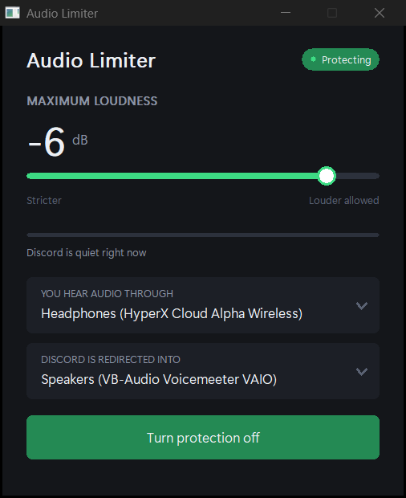

# Audio Limiter

**Stop people blowing your ears out in Discord voice.** A hard volume ceiling on everyone else, running quietly in your system tray. Normal talking sounds exactly the same. Screaming does not.

[](LICENSE)
[](#requirements)
[](#building-from-source)
[](https://github.com/S1MS4/audio-limiter/actions/workflows/build.yml)
[](https://github.com/S1MS4/audio-limiter/commits/main)
[](https://github.com/S1MS4/audio-limiter/stargazers)

<p align="center">
  <a href="https://github.com/S1MS4/audio-limiter/releases/latest"></a>&nbsp;
  <a href="#quick-start"></a>&nbsp;
  <a href="#how-it-works"></a>
</p>

<p align="center">
  <a href="#quick-start"><strong>Quick Start</strong></a> &nbsp;·&nbsp;
  <a href="#faq"><strong>FAQ</strong></a> &nbsp;·&nbsp;
  <a href="#roadmap"><strong>Roadmap</strong></a> &nbsp;·&nbsp;
  <a href="https://github.com/S1MS4/audio-limiter/issues"><strong>Report a problem</strong></a>
</p>

<p align="center">
  
</p>

---

## The Problem

Someone in your voice channel screams, drops a soundboard clip, or has their mic gain cranked to maximum. Your ears take the hit. You dive for the volume slider, and by the time you find it the damage is done.

Discord has no volume ceiling. It has never had one, and people have been [asking](https://support.discord.com/hc/en-us/community/posts/360061468432--Voice-Chat-Audio-Limiter) [for](https://support.discord.com/hc/en-us/community/posts/360068173192-Audio-Limiter) [years](https://support.discord.com/hc/en-us/community/posts/360062603392-Microphone-Channel-Loudness-Limit). Per-user volume sliders do not help, because you can only reach for them *after* it happens.

This fixes that. You set a maximum. Nothing gets past it. Ever.

### Why the volume mixer does not already do this

The Windows volume mixer **multiplies**. A limiter **compresses**. They are not the same operation.

Turn Discord down to 50% and everything scales together. The quiet talker and the screamer both drop by the same proportion, so the gap between them -- the thing actually hurting you -- is completely unchanged.

| | Quiet talker | Screamer | Can you hear both safely? |
|---|---|---|---|
| No adjustment | -30 dB | 0 dB | No, the screamer hurts |
| Mixer at 50% | -36 dB (inaudible) | -6 dB (still painful) | No, and now you lost the quiet one |
| Ceiling at -6 dB | -30 dB (untouched) | -6 dB (capped) | Yes |

The mixer forces a choice: hear quiet people, or do not get blasted. One slider moves everything, so you cannot have both. A limiter leaves everything below the line completely alone and only acts on what crosses it.

Discord's per-user volume sliders have the same problem -- they multiply too -- with the added flaw that you can only reach for them *after* it has already happened.

---

## What It Does

- **A hard ceiling on everyone** — set it once, and no one in voice can exceed it
- **Normal speech is untouched** — quiet talkers stay audible; only the spikes get caught
- **Instant reaction** — a lookahead buffer catches loud sounds before they reach your ears, not after
- **Discord only** — your music, games, and videos are completely unaffected
- **Set and forget** — lives in the system tray, starts with Windows, no configuration required
- **Nothing installed into Discord** — no client modification, no injection, no plugins, no account risk

---

## Quick Start

**1.** Download the installer from [Releases](https://github.com/S1MS4/audio-limiter/releases/latest)

**2.** Run it. Click through the prompts.

**3.** Done. It starts automatically and lives in your system tray.

No administrator rights, no UAC prompt, no config files, no command line, no Discord settings to change. To change the limit, right-click the tray icon and drag one slider.

> **Uninstalling puts your audio back exactly as it was.** Standard Windows uninstall, from Settings or the Start menu.

---

## How It Works

Most "audio limiter" ideas fail for a subtle reason: listening to Discord's audio does not stop it reaching your speakers. You would hear the raw sound and the processed sound at once, which is worse than doing nothing.

So this does not listen. It **redirects**.

```
Discord  ──►  private audio channel  ──►  limiter  ──►  your headphones
```

Discord's audio is sent into a private channel that only this app can hear. The app turns the volume down on anything too loud, then passes it along to your headphones. Because Discord's sound now goes *through* the app instead of *past* it, the loud version never reaches you at all.

Only Discord is redirected. Every other program on your computer is untouched.

<details>
<summary><strong>Technical details</strong></summary>

<br>

Routing uses `IAudioPolicyConfigFactory::SetPersistedDefaultAudioEndpoint`, the undocumented COM interface behind Windows' own per-app sound settings. Two vtable variants exist (Windows 11 21H2+ and Windows 10 pre-21H2) with different padding, so the factory is probed for the newer IID first. Interface layout transcribed from [EarTrumpet](https://github.com/File-New-Project/EarTrumpet) and [SoundSwitch](https://github.com/Belphemur/SoundSwitch).

Discord runs as multiple Electron processes and the one rendering audio is not the first `Discord.exe` you find. The target PID comes from enumerating live render sessions via `IAudioSessionManager2` and preferring active ones.

Audio is captured and rendered through WASAPI in shared mode, event-driven, with no allocation or locking on the audio threads and MMCSS "Pro Audio" scheduling. The limiter adds 5.02 ms of lookahead (pinned by a test); the rest of the ~35 ms end-to-end figure is capture and render buffering. The app reports its own measured latency in the footer.

Full design notes live in [fable-final-plan.md](fable-final-plan.md).

</details>

---

## Project Status

Working, and used daily by the author. Not yet packaged as a signed installer, so for now you build it yourself.

| Milestone | Status |
|---|---|
| Per-app routing on Windows 10/11 | Done |
| Discord audio process detection | Done |
| WASAPI capture and render pipeline | Done |
| Lookahead limiter (18 tests passing) | Done |
| Tray app and interface | Done |
| Crash recovery for routing | Done |
| Installer with clean uninstall | Done |
| Continuous integration | Done |
| Authenticode code signing | Not yet |

The installer is **not code-signed yet**, so Windows SmartScreen will warn you the first time you run it. Click "More info" then "Run anyway". Signing costs money and is the next thing on the list.

---

## Requirements

- Windows 10 (build 1903 or newer) or Windows 11
- Discord desktop, or any other app you want to cap
- A virtual audio device: [VB-CABLE](https://vb-audio.com/Cable/) (free) if you do not already run Voicemeeter or similar

Bundling a virtual device was attempted and does not currently work -- see [below](#why-is-a-virtual-audio-device-still-required).

Works with Discord, Vesktop, and Discord in a browser. It caps whatever the program plays, so it does not care which one you use.

---

## Building From Source

Requires CMake 3.20+ and either MSVC or MinGW-w64.

```bash
git clone https://github.com/S1MS4/audio-limiter.git
cd audio-limiter
cmake -B build
cmake --build build --config Release
```

<details>
<summary><strong>Building with MinGW-w64</strong></summary>

<br>

```bash
cmake -B build -G "MinGW Makefiles" \
  -DCMAKE_CXX_COMPILER=g++.exe \
  -DCMAKE_MAKE_PROGRAM=gmake.exe
cmake --build build
```

The source avoids `__uuidof`, WRL, and `IID_PPV_ARGS` so it compiles under both toolchains. GUID definitions are emitted by `src/guids.cpp`, since MinGW does not ship a Core Audio GUID library.

</details>

<details>
<summary><strong>Developer harness</strong></summary>

<br>

`m0spike` is a throwaway CLI used to verify the routing layer:

```
m0spike devices              list audio output devices
m0spike sessions             list running audio sessions
m0spike discord              identify Discord's audio process
m0spike get <pid>            read a process's current output device
m0spike route <pid> <devid>  send a process to a device
m0spike restore <pid>        undo it
```

Discord must have played audio at least once since launch before it appears as a session.

</details>

---

## FAQ

**Will this get my Discord account banned?**
No. Nothing is installed into Discord, no files are modified, and Discord's API is never touched. From Discord's point of view nothing has changed. This works the same way Voicemeeter and EqualizerAPO do, at the Windows audio layer.

**Does it affect my games and music?**
No. Only the program you point it at is redirected. Everything else plays normally.

**Will people sound quieter or muffled?**
No. Anything below your ceiling passes through completely unchanged. The limiter only engages on sounds that would have hurt.

**Does it add delay?**
About 35 milliseconds, which you will not notice. You are listening through it, not speaking through it, so it does not affect conversation timing.

**Can I use it on something other than Discord?**
Yes. It caps any application's output. Discord is just the obvious use case.

**Why is a virtual audio device still required?**
Redirecting is the only way to actually stop loud audio, and that needs somewhere to redirect *to* -- a private channel Discord gets pointed at so its sound reaches the limiter instead of going straight to your ears.

Bundling one was built and tested, and it does not work yet. The obvious candidate ([VirtualDrivers](https://github.com/VirtualDrivers/Virtual-Audio-Driver), MIT, distributed as "Signed") installs and then refuses to start with `CM_PROB_UNSIGNED_DRIVER` (code 52): its catalog is not attestation-signed for kernel-mode loading, so Windows will not load it unless the machine is in test-signing mode. Shipping it would hand every user a broken device in Device Manager. The install code is written and works; it needs a driver Windows will accept.

**Do I have to configure anything?**
No. There is one switch. The default ceiling catches screaming and soundboard spam while leaving normal conversation alone. If you want to tune it, everything else is behind "Advanced".

**Is there something I can try right now, for free?**
Yes, and you should try it first. Windows has a built-in compressor: **Sound Control Panel → your output device → Properties → Enhancements → Loudness Equalization**. It affects every program rather than just Discord, and some audio drivers do not offer it, but it costs nothing and it is already on your machine. If it solves your problem, you do not need this.

---

## Why not just use Voicemeeter?

Honest answer: Voicemeeter can do this, and if you already run it, you may not need this at all. It has per-bus limiters, and pointing Discord at a virtual input and limiting that bus achieves the same result.

What this does differently is remove the setup. Voicemeeter asks you to understand a mixer -- virtual inputs, buses, patch routing -- and to point Discord at the right device by hand. This finds Discord's audio process itself, routes it, and gives you one switch. It also re-finds Discord when it restarts under a new process id, which a static mixer configuration will not do.

It is a usability product, not a capability one, and it still sits on top of a virtual audio device rather than replacing the need for one. If you are comfortable in Voicemeeter and have it configured already, you are not missing much. If the words "virtual input bus" made you close the tab, this is for you.

To be clear about what it cannot do: **per-speaker limits are not possible in this design.** By the time Discord's audio reaches Windows it is already mixed to one stream, so individual voices cannot be separated. That would require running inside Discord, which this deliberately does not do.

---

## Roadmap

- An attestation-signed virtual audio device, so there is no prerequisite
- Authenticode signing so SmartScreen stops warning
- A real project name

---

## Contributing

Early days, but issues and ideas are welcome. If you have hit the loud-user problem and have opinions about how this should behave, that is genuinely useful.

---

## License

MIT — see [LICENSE](LICENSE). Use it, fork it, ship it, no obligations.

---

## Author

**S1MS4** — [GitHub](https://github.com/S1MS4)

Built because someone screamed into a microphone one too many times.
